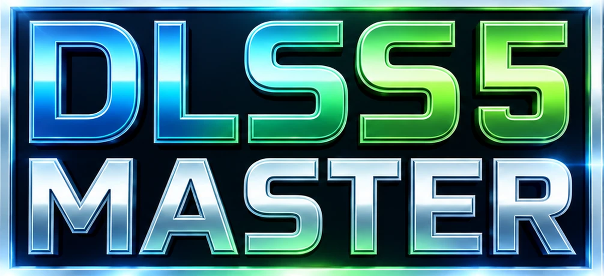
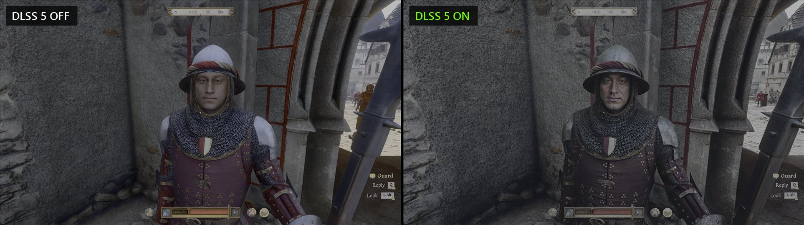
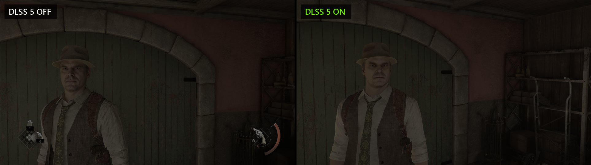
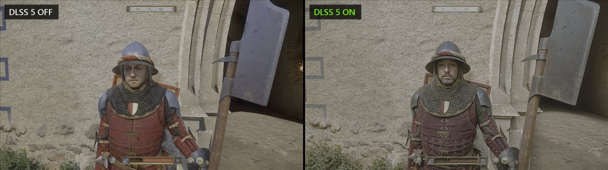
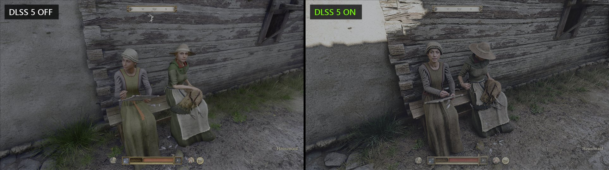
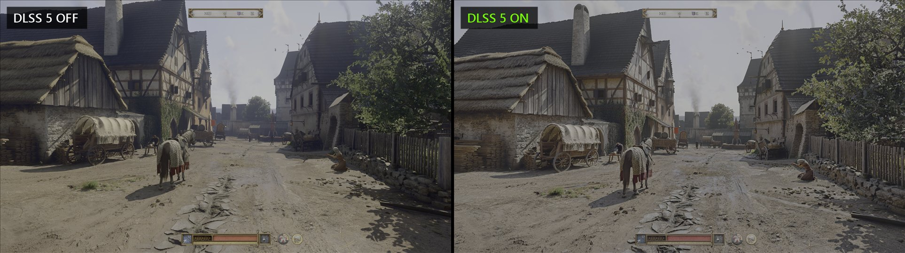
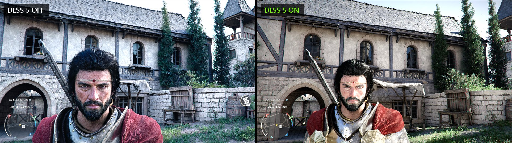
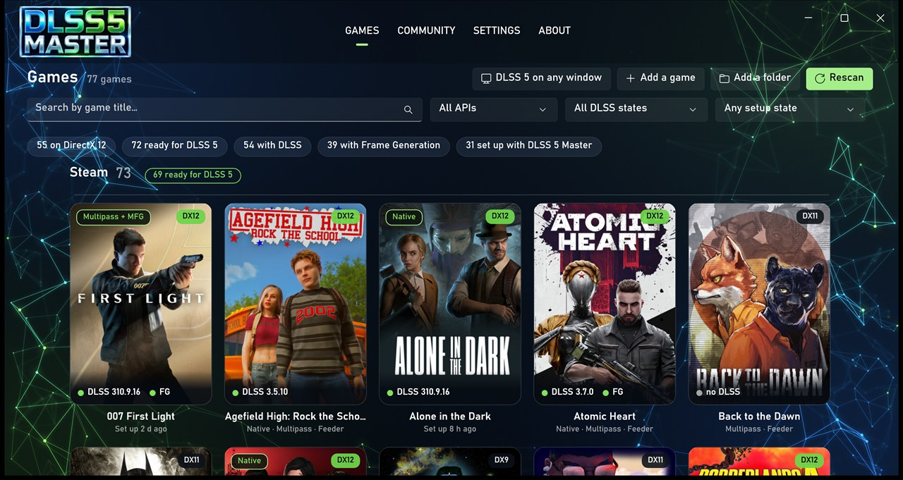
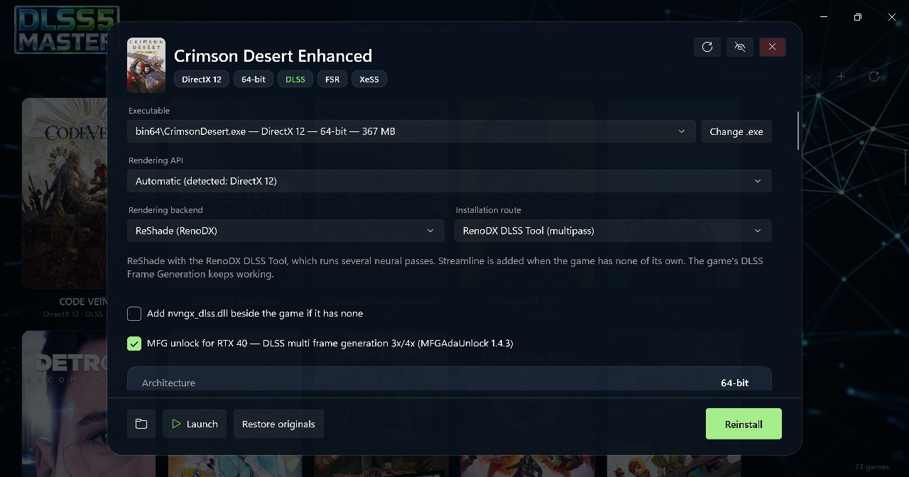
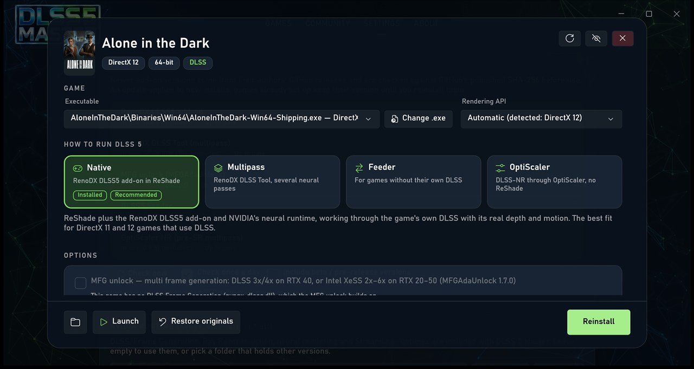

<p align="center">
  
</p>

<p align="center">
  <b>DLSS 5 neural rendering for your PC games, in one app.</b><br>
  ReShade + RenoDX routes, OptiScaler, multi frame generation (RTX 20–50), DLL swapping and an exact restore. One click per game.
</p>

<p align="center">
  <a href="../../releases/latest"></a>
  <a href="../../releases"></a>
  <a href="LICENSE"></a>
</p>

---

## See the difference





<details>
<summary><b>More comparisons</b> (Kingdom Come: Deliverance II, Crimson Desert)</summary>






</details>

## Your whole library, ready in one place



## Pick a route, tick MFG, done



## Always up to date

DLSS 5 Master checks GitHub for newer RenoDX, MFG unlock, Feeder and OptiScaler releases and for new versions of itself. Every download is checked against GitHub's published SHA-256 before it is used.



## How it works

1. **[Download the installer](../../releases/latest)** and run it. Everything is included: no other tools, no extra downloads.
2. **Pick a game.** DLSS 5 Master finds your Steam, Epic, GOG, Ubisoft and Xbox games by itself and recommends the best route for each one.
3. **Press *Set up DLSS 5*** and play. Changed your mind? **Restore originals** puts the game back exactly as it was.

> Windows may show *"Windows protected your PC"* because the installer is not code-signed yet. Click **More info → Run anyway**.

## Features

- **Game library**: finds Steam, Epic, GOG, Ubisoft, Xbox and custom-folder games, with cover art, and detects each game's executable, DirectX/Vulkan version, 32/64-bit, and DLSS / FSR / XeSS / Streamline DLLs.
- **ReShade + RenoDX routes**: *Native* (RenoDX DLSS5 add-on, through the game's own DLSS, DirectX 11 or 12), *Multipass* (RenoDX DLSS Tool) and *DLSS5 Feeder*. Feeder supports DirectX 11, DirectX 12, OpenGL and Vulkan games without native DLSS. Vulkan uses a full-add-on ReShade layer already registered for the selected executable and requires NVIDIA Smooth Motion to be off. If ReShade cannot start the add-ons in a game (error 1114 in its log), the game's page offers to have ReShade load them as soon as it starts.
- **GITC Uplift** runs neural rendering through ReShade in DirectX 9–12, OpenGL and Vulkan games. Vulkan uses a full-add-on ReShade layer registered for the game. In game, open ReShade with **Home** and select **Enable** in the **GITC Uplift** tab.
- **OptiScaler** bundles OptiScaler NR pre-SR MFG 0.9.95. The NR 0.8.3 RTX 40 MFG build is available on first use. You choose the proxy DLL name (`dxgi`, `winmm`, `version`, …) and the in-game menu key.
- **DLSS 5 Neural Rendering (NR) add-on** - supplied separately. Select its folder or ZIP in Settings; the add-on is not included or downloaded by DLSS 5 Master. The route title uses the supplied add-on's product metadata.
- **Several games at once**: *Bulk install* on the Games page sets one route up in every shown game it fits. Each game is ticked; untick any you want to leave as it is. Games the route does not fit, and games with anti-cheat, are left as they are and listed with the reason. Games already set up are set up again only if you ask.
- **MFG unlock**: [MFGAdaUnlock-RenoDx](https://github.com/mavismmg/MFGAdaUnlock-RenoDx) as a tick box on every ReShade route: DLSS multi frame generation (3x/4x) on GeForce RTX 40, or its XeMFG mode (Intel XeSS frame generation, 2x–6x) on RTX 20, 30, 40 and 50.
- **DLL swapping**: swap any upscaler DLL for another version from your DLL library.
- **Exact restore**: every file added or replaced is recorded in `_DLSS5Master_Backup` inside the game folder; *Restore originals* puts the game back byte for byte, and also removes the logs and crash dumps the add-ons wrote while the game ran. It can also remove installs made by other DLSS 5 tools, and sets aside the DLSS 5 add-ons they left in a game's folder (ReShade would load them too); Restore puts those back as well.
- **Community**: every game shows what other players report (works / partly / broken), each report with its route and the PC it ran on (graphics card and driver, processor, memory, Windows). The Community tab has every reported game with filters, a chat, a screenshot gallery (approved before anyone sees it) and a private line to the developer. Pick a nickname; no account needed.
- **Updates**: the app and its add-ons update themselves from GitHub, checked against GitHub's published SHA-256.
- **Runtime updates**: Settings → Components checks SR, RR, FG and NR against the DLSS release mirror, and Streamline against RankFTW/rhi-repo releases (pinned to 2.13.0.0 until 2.14 neural rendering compatibility is tested). Each runtime has an Update and Use included control; Update available runtimes selects all newer verified releases. Streamline uses one complete release set. Updates are kept in the app's data folder for new setups; custom runtime folders keep priority and installed games are unchanged until reinstalled.
- **DLSS 5 on any window**: draws DLSS 5 over a browser, a video or any other open window, for browsing and videos; nothing in that program is changed. Optional frame generation (2x, 3x or 4x), Quality / Balanced / Performance, 1 or 2 neural passes, and HDR on an HDR screen. F9 switches it on and off. A window in exclusive fullscreen hides every overlay: the overlay then waits without using the graphics card and says so. Games use the routes above.

> **Anti-cheat warning:** injecting DLLs into online games can get your account banned, and anti-cheat often refuses to load ReShade's add-on build at all (ReShade says it is for single-player games). DLSS 5 Master names the anti-cheat it finds in a game's folder (Easy Anti-Cheat, BattlEye, EA Javelin, RICOCHET, ACE, GameGuard, XIGNCODE3 and others) and asks you to confirm before a setup; *Bulk install* leaves those games out. Anti-cheat that lives outside the game folder (Riot Vanguard, FACEIT's client, VAC) cannot be seen.

## Requirements

- Windows 10 1809 or newer, x64
- An NVIDIA RTX graphics card for the DLSS routes (MFG unlock: DLSS mode on RTX 40, XeMFG mode on RTX 20–50)
- DLSS 5 on any window: an NVIDIA RTX card; its frame generation on RTX 20/30 needs NVIDIA driver R580 or newer

## Feedback

Found a bug or have an idea? In the app, **About → Report a problem** opens a new issue with your app version, Windows version and graphics card already filled in. You can also use [Issues](../../issues), the in-app **Community → Chat**, or write privately under **Community → Private**.

## Support

DLSS 5 Master is free. If it saved you time, you can support its development:

[](https://www.buymeacoffee.com/Liongooder)

---

## Build from source

Prerequisites: [.NET 10 SDK](https://dotnet.microsoft.com/download/dotnet/10.0), [Inno Setup 6](https://jrsoftware.org/isinfo.php) and, for the overlay helper (`src/Overlay`, C++), Visual Studio 2022 Build Tools with the C++ workload. `src/Overlay/build.bat` builds the helper; its `fetch-sdk.ps1` downloads the NVIDIA headers it compiles against (pinned SHA-256), and `build-installer.ps1` runs it for you.

```powershell
# app only
dotnet build src/DLSS5Master -c Release

# self-contained app + installer -> dist/DLSS5Master-Setup-<version>.exe
powershell -ExecutionPolicy Bypass -File build-installer.ps1
```

`tests/CoreTests` runs the core unit tests (`dotnet run --project tests/CoreTests`). `tests/CoreProbe` is a read-only console tool that scans your game library and prints what the app would detect, without changing anything. The community server (Cloudflare Worker + D1) is in `community/`.

## Third-party components

The installer bundles these components, unmodified and checked against the pinned SHA-256 list in `installer/payload-manifest.csv`. They are not stored in this repository: `build-installer.ps1` downloads the open-source ones from their release pages and copies the rest from `-PayloadSource`. Other OptiScaler builds are downloaded from their release pages when first used.

| Component | Source | Licence |
|---|---|---|
| OptiScaler NR pre-SR MFG 0.9.95 (bundled with dlssg_for_sm86 for overlay frame generation on RTX 20/30) | [ShyVortex/OptiScaler-NR-PreSR-MFG at v0.9.95](https://github.com/ShyVortex/OptiScaler-NR-PreSR-MFG/tree/v0.9.95), [sdli1995/dlssg_for_sm86](https://github.com/sdli1995/dlssg_for_sm86) | GPL-3.0 |
| OptiScaler NR pre-SR multipass 0.8.3 RTX 40 MFG (downloaded when chosen) | [wilsjo2/OptiScaler-DLSSNR-PreSR-Multipass](https://github.com/wilsjo2/OptiScaler-DLSSNR-PreSR-Multipass) | GPL-3.0 |
| DLSS5-Feeder | [jlrouzies-fr/DLSS5-Feeder](https://github.com/jlrouzies-fr/DLSS5-Feeder) | MIT |
| GITC Uplift 2.0.0 | by [ghostinthecamera](https://github.com/ghostinthecamera/GITC-Uplift), [release](https://github.com/ghostinthecamera/GITC-Uplift/releases/tag/v2.0.0) | MIT |
| RenoDX DLSS5 add-on | Built on [RenoDX](https://github.com/clshortfuse/renodx) (MIT); builds via [RankFTW/rhi-repo](https://github.com/RankFTW/rhi-repo) | No licence published |
| RenoDX DLSS Tool | by ShortFuse; builds via [RankFTW/rhi-repo](https://github.com/RankFTW/rhi-repo) | No licence published |
| NVIDIA DLSS / Frame Gen / Ray Reconstruction / neural rendering runtimes, Streamline | NVIDIA | NVIDIA licence (included) |
| MFGAdaUnlock-RenoDx (multi frame generation, DLSS-G and XeMFG) | [mavismmg/MFGAdaUnlock-RenoDx](https://github.com/mavismmg/MFGAdaUnlock-RenoDx) | MIT |
| vort_Shaders | [vortigern11/vort_Shaders](https://github.com/vortigern11/vort_Shaders) | MIT |
| ReShade | [reshade.me](https://reshade.me) | BSD-3-Clause |
| Overlay helper build inputs: NVIDIA NGX SDK, NVIDIA Optical Flow SDK interface headers | [NVIDIA/DLSS](https://github.com/NVIDIA/DLSS), NVIDIA Optical Flow SDK | NVIDIA RTX SDKs licence; BSD-3-Clause |

The installer includes the Microsoft .NET runtime, the Windows App SDK and, beside the overlay helper, the Microsoft Visual C++ runtime, redistributed under their licences. Game screenshots and cover art belong to their publishers and are shown only to illustrate the app.

## Code signing policy and privacy

See [CODE_SIGNING_POLICY.md](CODE_SIGNING_POLICY.md), including its [privacy section](CODE_SIGNING_POLICY.md#privacy).

## Licence

[MIT](LICENSE)

### Local workflow tools

Bulk install has a file/version preview with original-backup and rollback-storage estimates before installation. The copy list is conservative: existing newer runtimes can be retained and small configuration files are generated/merged separately. Update installed games previews and reinstalls selected managed games using their recorded route/build/hooks, preserving their in-game tuning and working MFG providers; unsupported/development routes, anti-cheat and other installers are excluded.

In-game settings are saved locally per game/executable, route, architecture and OptiScaler build. Returning to a route restores its profile. Install and restore operations take write-ahead snapshots of changed files; failures restore the previous setup, and interrupted operations can recover on the next install/restore. Recovery snapshots remain if locked files prevent rollback.

Settings → Activity log → Export support ZIP previews the exact allowlisted, redacted text before saving locally. It includes hardware/runtime versions, managed install details and the recent activity log; no DLLs, private add-ons, complete settings or community identity files are exported. Nothing is uploaded. Community compatibility reports can be filtered by route, GPU, driver and reported result; these remain player reports, not verified compatibility certifications. Local add-on titles come from the supplied binary's product metadata, with DLSS5 NR as a fallback.
