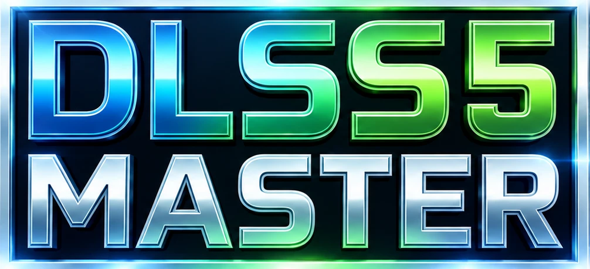
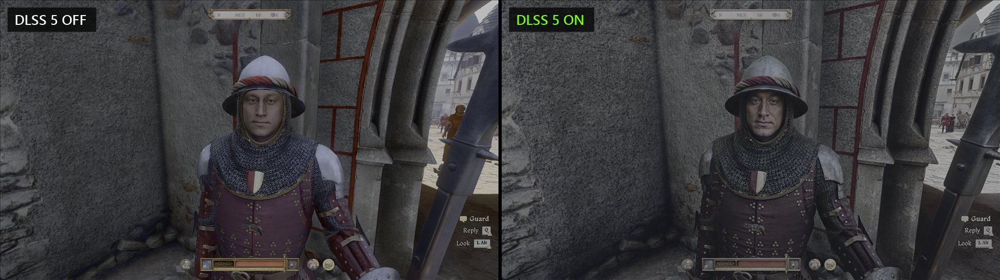
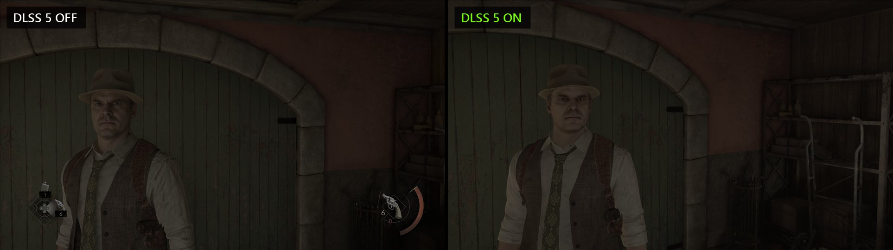
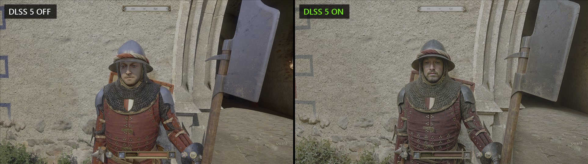
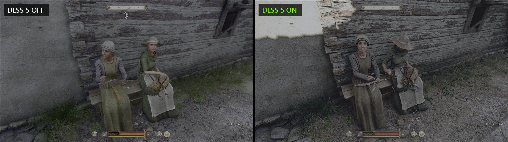
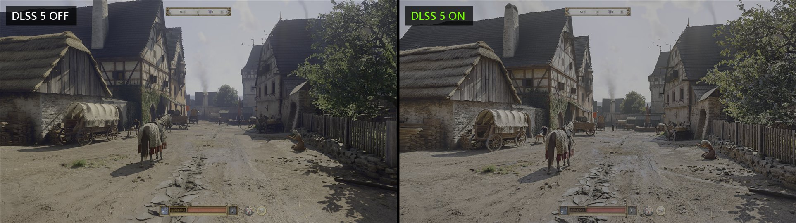
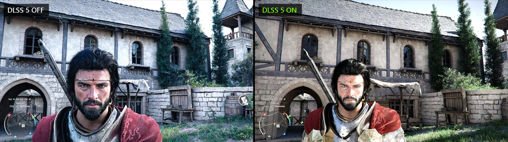
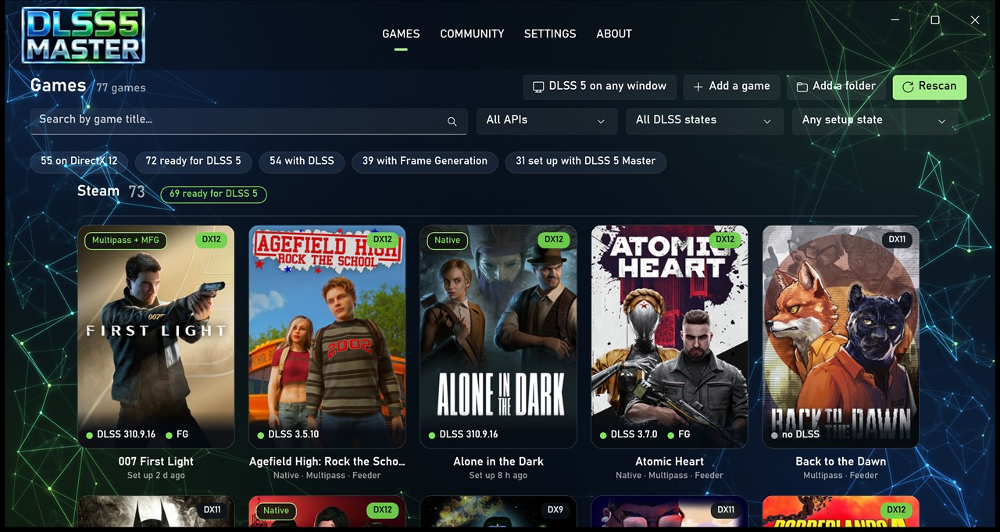
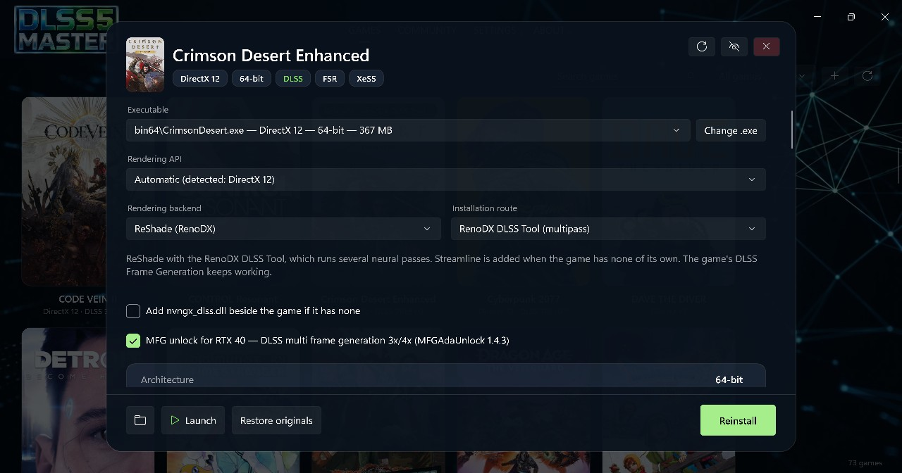
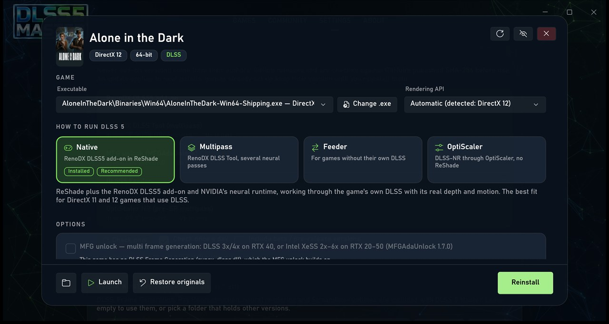

<p align="center">
  
</p>

<p align="center">
  <b>DLSS 5 neural rendering for your PC games, in one app.</b><br>
  ReShade + RenoDX routes, OptiScaler, multi frame generation (RTX 20–50), DLL swapping and an exact restore. One click per game.
</p>

<p align="center">
  <a href="../../releases/latest"></a>
  <a href="../../releases"></a>
  <a href="LICENSE"></a>
</p>

---

## See the difference





<details>
<summary><b>More comparisons</b> (Kingdom Come: Deliverance II, Crimson Desert)</summary>






</details>

## Your whole library, ready in one place



## Pick a route, tick MFG, done



## Always up to date

DLSS 5 Master checks GitHub for newer RenoDX, MFG unlock, Feeder and OptiScaler releases and for new versions of itself. Every download is checked against GitHub's published SHA-256 before it is used.



## How it works

1. **[Download the installer](../../releases/latest)** and run it. Everything is included: no other tools, no extra downloads.
2. **Pick a game.** DLSS 5 Master finds your Steam, Epic, GOG, Ubisoft and Xbox games by itself and recommends the best route for each one.
3. **Press *Set up DLSS 5*** and play. Changed your mind? **Restore originals** puts the game back exactly as it was.

> Windows may show *"Windows protected your PC"* because the installer is not code-signed yet. Click **More info → Run anyway**.

## Features

- **Game library**: finds Steam, Epic, GOG, Ubisoft, Xbox and custom-folder games, with cover art, and detects each game's executable, DirectX/Vulkan version, 32/64-bit, and DLSS / FSR / XeSS / Streamline DLLs.
- **ReShade + RenoDX routes**: *Native* (RenoDX DLSS5 add-on), *Multipass* (RenoDX DLSS Tool) and *DLSS5 Feeder* (for games without DLSS).
- **OptiScaler**: the NR 0.8.3 RTX 40 MFG build is included, plus other DLSS-NR builds or your own OptiScaler folder, a choice of proxy DLL name (`dxgi`, `winmm`, `version`, …) and the in-game menu key.
- **MFG unlock**: [MFGAdaUnlock-RenoDx](https://github.com/mavismmg/MFGAdaUnlock-RenoDx) as a tick box on every ReShade route: DLSS multi frame generation (3x/4x) on GeForce RTX 40, or its XeMFG mode (Intel XeSS frame generation, 2x–6x) on RTX 20, 30, 40 and 50.
- **DLL swapping**: swap any upscaler DLL for another version from your DLL library.
- **Exact restore**: every file added or replaced is recorded in `_DLSS5Master_Backup` inside the game folder; *Restore originals* puts the game back byte for byte. It can also remove installs made by other DLSS 5 tools.
- **Community**: every game shows what other players report (works / partly / broken) by route and graphics card. The Community tab has every reported game with filters, a chat, a screenshot gallery (approved before anyone sees it) and a private line to the developer. Pick a nickname; no account needed.
- **Updates**: the app and its add-ons update themselves from GitHub, checked against GitHub's published SHA-256.

> **Anti-cheat warning:** injecting DLLs into online games can get your account banned. DLSS 5 Master asks you to confirm this for games that ship anti-cheat.

## Requirements

- Windows 10 1809 or newer, x64
- An NVIDIA RTX graphics card for the DLSS routes (MFG unlock: DLSS mode on RTX 40, XeMFG mode on RTX 20–50)

## Feedback

Found a bug or have an idea? In the app, **About → Report a problem** opens a new issue with your app version, Windows version and graphics card already filled in. You can also use [Issues](../../issues), the in-app **Community → Chat**, or write privately under **Community → Private**.

## Support

DLSS 5 Master is free. If it saved you time, you can support its development:

[](https://www.buymeacoffee.com/Liongooder)

---

## Build from source

Prerequisites: [.NET 10 SDK](https://dotnet.microsoft.com/download/dotnet/10.0) and [Inno Setup 6](https://jrsoftware.org/isinfo.php).

```powershell
# app only
dotnet build src/DLSS5Master -c Release

# self-contained app + installer -> dist/DLSS5Master-Setup-<version>.exe
powershell -ExecutionPolicy Bypass -File build-installer.ps1
```

`tests/CoreTests` runs the core unit tests (`dotnet run --project tests/CoreTests`). `tests/CoreProbe` is a read-only console tool that scans your game library and prints what the app would detect, without changing anything. The community server (Cloudflare Worker + D1) is in `community/`.

## Third-party components

The installer bundles these components, unmodified and checked against the pinned SHA-256 list in `installer/payload-manifest.csv`. They are not stored in this repository: `build-installer.ps1` downloads the open-source ones from their release pages and copies the rest from `-PayloadSource`. Other OptiScaler builds are downloaded from their release pages when first used.

| Component | Source | Licence |
|---|---|---|
| OptiScaler NR pre-SR multipass 0.8.3 (incl. RTX 40 MFG edition) | [wilsjo2/OptiScaler-DLSSNR-PreSR-Multipass](https://github.com/wilsjo2/OptiScaler-DLSSNR-PreSR-Multipass) | GPL-3.0 |
| OptiScaler DLSS-NR | [Dagherbou/OptiScaler_DLSSNR](https://github.com/Dagherbou/OptiScaler_DLSSNR) | GPL-3.0 |
| OptiScaler DLSS-NR pre-SR multipass | [jlrouzies-fr/OptiScaler-DLSSNR-PreSR-Multipass](https://github.com/jlrouzies-fr/OptiScaler-DLSSNR-PreSR-Multipass) | GPL-3.0 |
| DLSS5-Feeder | [jlrouzies-fr/DLSS5-Feeder](https://github.com/jlrouzies-fr/DLSS5-Feeder) | MIT |
| RenoDX DLSS5 add-on / DLSS Tool | [clshortfuse/renodx](https://github.com/clshortfuse/renodx), builds via [RankFTW/rhi-repo](https://github.com/RankFTW/rhi-repo) | MIT |
| NVIDIA DLSS / Frame Gen / Ray Reconstruction / neural rendering runtimes, Streamline | NVIDIA | NVIDIA licence (included) |
| MFGAdaUnlock-RenoDx (multi frame generation, DLSS-G and XeMFG) | [mavismmg/MFGAdaUnlock-RenoDx](https://github.com/mavismmg/MFGAdaUnlock-RenoDx) | MIT |
| vort_Shaders | [vortigern11/vort_Shaders](https://github.com/vortigern11/vort_Shaders) | MIT |
| ReShade | [reshade.me](https://reshade.me) | BSD-3-Clause |

The installer includes the Microsoft .NET runtime and Windows App SDK, redistributed under their licences. Game screenshots and cover art belong to their publishers and are shown only to illustrate the app.

## Code signing policy and privacy

See [CODE_SIGNING_POLICY.md](CODE_SIGNING_POLICY.md), including its [privacy section](CODE_SIGNING_POLICY.md#privacy).

## Licence

[MIT](LICENSE)
